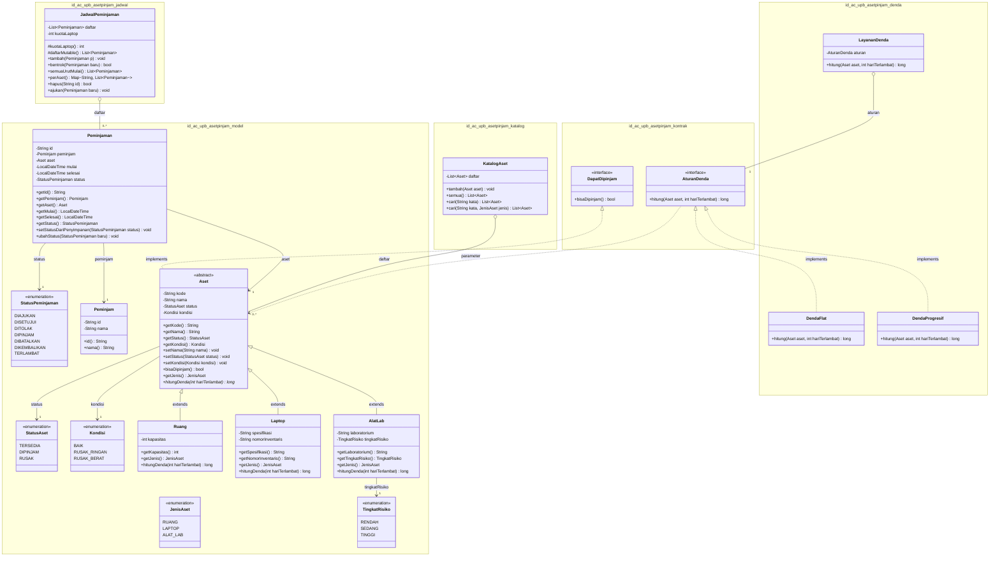

# Class Diagram Sistem Aset-Pinjam

Berikut adalah diagram kelas UML sistem Aset-Pinjam yang mencakup seluruh paket model, kontrak, denda, jadwal, dan katalog.

## Deskripsi Elemen Diagram

1. **Paket `id.ac.upb.asetpinjam.model`**:
   - Berisi kelas inti domain entitas: `Aset` (kelas abstrak), `Ruang`, `Laptop`, `AlatLab` (turunan konkret dari `Aset`), `Peminjam` (record), dan `Peminjaman`.
   - Enumerasi untuk status dan atribut: `StatusAset`, `Kondisi`, `JenisAset`, `StatusPeminjaman`, `TingkatRisiko`.
2. **Paket `id.ac.upb.asetpinjam.kontrak`**:
   - Berisi interface kontrak pemodelan: `DapatDipinjam` (abstraksi aset yang dapat dipinjam) dan `AturanDenda` (abstraksi kalkulasi denda - Pola Strategy).
3. **Paket `id.ac.upb.asetpinjam.denda`**:
   - Implementasi strategi denda: `DendaFlat` dan `DendaProgresif`, serta kelas konteks `LayananDenda`.
4. **Paket `id.ac.upb.asetpinjam.katalog`**:
   - `KatalogAset`: Menyimpan koleksi dan menyediakan fungsi pencarian aset.
5. **Paket `id.ac.upb.asetpinjam.jadwal`**:
   - `JadwalPeminjaman`: Menyimpan koleksi peminjaman, validasi bentrok waktu, kuota, dan pengurutan jadwal.
