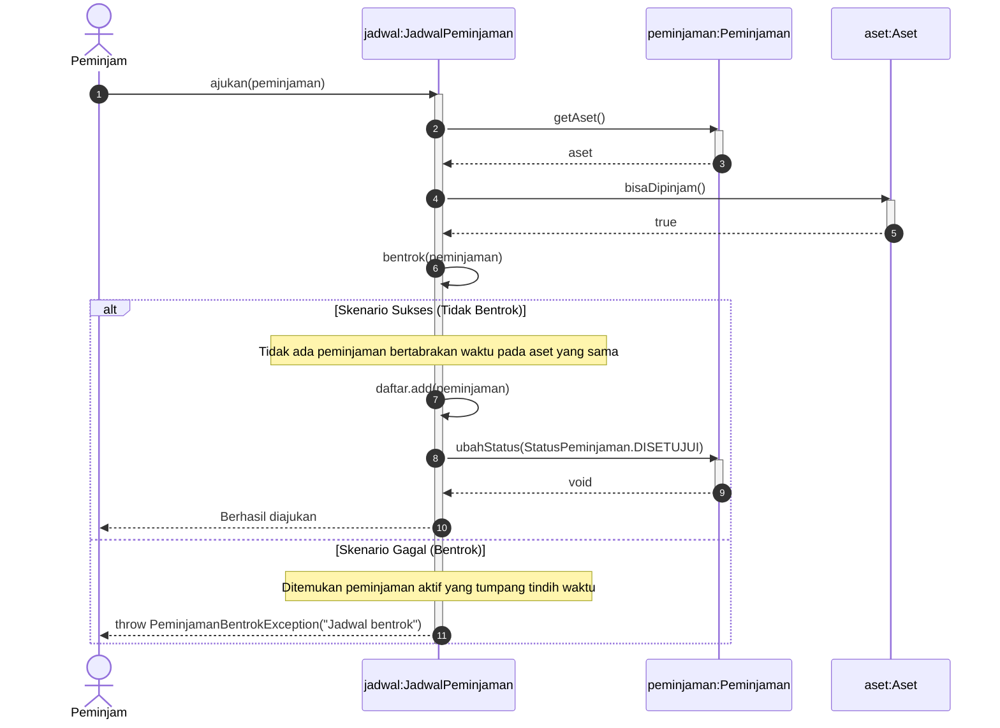

# Sequence Diagram: Pengajuan Peminjaman

Diagram interaksi ini menunjukkan skenario pengajuan peminjaman aset (`ajukan(peminjaman)`), memodelkan alur sukses serta alur bentrok menggunakan fragmen `alt`.

## Penjelasan Skenario

1. **Aktor `Peminjam`** memanggil method `ajukan(peminjaman)` pada objek `JadwalPeminjaman`.
2. `JadwalPeminjaman` mengambil referensi aset yang bersangkutan melalui `peminjaman.getAset()`.
3. `JadwalPeminjaman` memeriksa kelayakan status dan kondisi aset via `aset.bisaDipinjam()`.
4. `JadwalPeminjaman` memanggil method internal `bentrok(peminjaman)` untuk mengecek tumpang tindih waktu terhadap jadwal peminjaman yang sudah ada pada aset yang sama.
5. **Fragmen `alt`**:
   - **Skenario Sukses**: Bila tidak terjadi bentrok (`false`), objek `peminjaman` ditambahkan ke dalam daftar jadwal (`daftar.add(peminjaman)`), status peminjaman diubah menjadi `DISETUJUI` melalui `ubahStatus()`, dan konfirmasi berhasil dikembalikan ke peminjam.
   - **Skenario Gagal (Bentrok)**: Bila terjadi bentrok waktu (`true`), eksekusi dialihkan ke cabang `else` dan sistem melempar exception `PeminjamanBentrokException` sehingga pengajuan ditolak.
